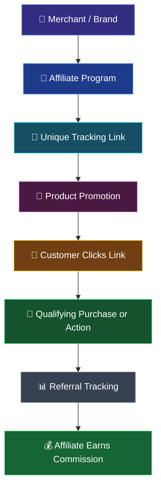

# 🚀 Affiliate Marketing
### A Powerful Model of Digital Marketing

<p align="center">
  
  
  
</p>

<p align="center">
  <b>Explore how digital creators, businesses, and affiliate platforms work together to generate performance-based revenue.</b>
</p>

---

## 📌 About the Project

Affiliate marketing is a performance-based digital marketing model in which individuals or content creators promote products and services through unique referral links and earn commissions when qualifying actions occur.

This academic group project explores the fundamentals of affiliate marketing, its working process, commission structures, promotional channels, popular platforms, advantages, challenges, and emerging trends.

The project combines research, real-world examples, and presentation-based learning to explain how affiliate marketing contributes to the modern digital economy.

## 🎓 Project Information

| Detail | Description |
|---|---|
| **Project Title** | Affiliate Marketing — A Powerful Model of Digital Marketing |
| **Course** | Bachelor of Computer Applications (BCA) |
| **Department** | CSIT |
| **Project Type** | Academic Group Project |
| **Presented By** | Tanishtha, Ritesh, Yash, and Devashis |
| **Submitted To** | Ratnesh Srivastava Sir |

---

## ⚡ How Affiliate Marketing Works

Affiliate marketing connects businesses with affiliates who promote their products or services to potential customers.

The process follows a simple workflow:



### 🔄 Step-by-Step Workflow

1. **Join an Affiliate Program:** Register with a company or affiliate network.
2. **Get a Tracking Link:** Receive a unique URL associated with your affiliate account.
3. **Promote Products:** Share products through social media, blogs, websites, videos, or other channels.
4. **Attract Customers:** Interested users click the affiliate link.
5. **Generate a Conversion:** A qualifying sale, lead, click, or other action occurs, depending on the program.
6. **Track Performance:** The platform records eligible referrals and conversions.
7. **Earn Commission:** Receive payment according to the program's rules and commission structure.

> **Key idea:** Affiliates promote products; merchants provide the products; tracking systems attribute eligible referrals; and commissions reward qualifying performance.

---

## 👥 Team Members & Contributions

This project was prepared collaboratively, with each member contributing to a specific part of the work.

| Team Member | Role & Contribution |
|---|---|
| **Tanishtha** | Presentation delivery and explanation of the main topics. |
| **Ritesh** | Research, information collection, PowerPoint preparation, and content organization. |
| **Yash** | Technical support, troubleshooting, and assistance with the presentation and related work. |
| **Devashis** | Team coordination, collaboration, and support for overall project completion. |

**Faculty Guide:** Ratnesh Srivastava Sir

---

## 📚 Topics Covered

### 01. Introduction to Affiliate Marketing
- Definition and basic concept
- Tracking links and performance-based payments

### 02. Key Participants
- Merchant or advertiser
- Affiliate or publisher
- Customer
- Affiliate network

### 03. Importance of Affiliate Marketing
- Business growth and wider audience reach
- Opportunities to monetize digital content

### 04. Promotional Channels
- Websites and blogs
- Social media platforms
- Video content and creators
- Email marketing
- Influencer marketing

### 05. How It Works
- Joining affiliate programs
- Generating tracking links
- Promoting products
- Tracking conversions and earning commissions

### 06. Commission Models
- **PPS:** Pay Per Sale
- **PPC:** Pay Per Click
- **PPL:** Pay Per Lead
- **Recurring Commission:** Repeated eligible payments under applicable program terms

### 07. Popular Affiliate Platforms

| Platform | General Purpose |
|---|---|
| Amazon Associates | Promoting eligible Amazon products |
| EarnKaro | Sharing deals and earning referral commissions |
| Cuelinks | Affiliate monetization and link management |
| CJ Affiliate | Affiliate partnerships between publishers and advertisers |
| Impact | Partnership and affiliate marketing management |

### 08. Real-World Examples
- Technology reviews on YouTube
- Fashion recommendations on Instagram
- Product comparison blogs
- Deal-sharing channels on Telegram

### 09. Advantages, Challenges & Solutions
- Low initial investment for many affiliate models
- Flexible promotional channels
- Competition and changing commission policies
- The importance of audience trust and transparent disclosures

### 10. Future Trends
- AI-driven campaign optimization
- Short-form video commerce
- Micro- and nano-influencer marketing
- Mobile-first shopping experiences

---

## 💰 Example: How Commission Is Calculated

Imagine an affiliate promotes a product worth ₹2,000 with a commission rate of 5%.

<p align="center">
  
  
</p>

### Calculation

\[
\text{Commission} = \text{Product Price} \times \frac{\text{Commission Rate}}{100}
\]

\[
= ₹2{,}000 \times \frac{5}{100} = ₹100
\]

**Result: ₹100 per qualifying sale**, assuming the program applies a 5% commission to the full product price.

Actual earnings depend on the platform's commission rules, eligible orders, tracking, returns, and payment terms.

---

## 🌟 Advantages of Affiliate Marketing

| Advantage | Explanation |
|---|---|
| **Cost-Effective Promotion** | Businesses can pay commissions for defined results instead of relying only on traditional advertising. |
| **Wider Reach** | Affiliates can connect products with different audiences. |
| **Flexible Channels** | Products can be promoted through videos, blogs, websites, and social media. |
| **Content Monetization** | Creators can earn from relevant recommendations. |
| **Performance Tracking** | Tracking links and dashboards can help measure referrals and conversions. |

## ⚠️ Challenges to Consider

- High competition in popular product categories
- Changes to commission rates and affiliate policies
- Dependence on platform tracking and attribution
- Building trust with an audience
- The need to disclose affiliate relationships honestly

## 🔮 Future of Affiliate Marketing

Affiliate marketing continues to evolve alongside digital commerce. Emerging opportunities include AI-assisted content analysis, short-form video promotions, creator partnerships, personalized recommendations, and smoother mobile shopping experiences.

Successful affiliate marketing depends not only on generating clicks but also on relevance, trust, transparent communication, and genuine value for customers.

---

## 🧠 Key Learnings

- Affiliate marketing connects merchants, affiliates, customers, and affiliate networks.
- Unique tracking links help attribute eligible referrals.
- Commission models reward different qualifying actions.
- Social media, video platforms, and websites provide opportunities for product promotion.
- Ethical promotion, honest disclosures, and audience trust support long-term success.

---

## 📂 Repository Contents

```text
affiliate-marketing-project/
│
├── README.md
└── Affiliate Marketing Presentation (1).pdf
```

| File | Description |
|---|---|
| `README.md` | Project overview, workflow, team contributions, and learning outcomes |
| `Affiliate Marketing Presentation (1).pdf` | Original academic presentation slides |

---

## 📖 How to View the Project

1. Open the presentation PDF in this repository.
2. Preview it directly on GitHub or download it.
3. Use any standard PDF reader to view the slides.

This is a **presentation-based academic project**, not a software application. No installation or build process is required.

---

## 🏁 Conclusion

Affiliate marketing represents an important model of modern digital marketing, connecting brands, content creators, and consumers through trackable referrals and performance-based commissions.

Through this collaborative project, the team explored the affiliate marketing workflow, common commission structures, promotional platforms, real-world examples, challenges, and future opportunities in the digital economy.

---

<p align="center">
  <b>🎓 Academic Group Project | BCA | Department of CSIT</b>
  <br>
  <i>Prepared by Tanishtha, Ritesh, Yash, and Devashis</i>
</p>
