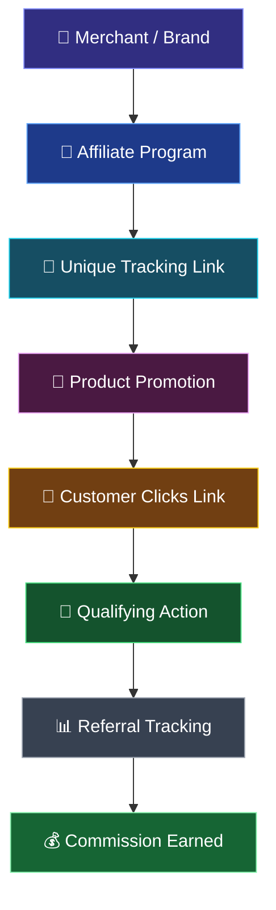

# 🚀 Affiliate Marketing
### A Powerful Model of Digital Marketing

  
  
  

  <b>Understanding how brands, digital creators, and customers connect through performance-based marketing.</b>

---

## 📌 Project Overview

Affiliate marketing is a performance-based digital marketing model in which individuals or content creators promote products and services through unique tracking links and earn commissions when qualifying actions occur.

This academic group project explores the fundamentals of affiliate marketing, its working process, commission models, promotional channels, popular platforms, advantages, challenges, and future trends. It combines research, practical examples, and collaborative presentation work to explain the role of affiliate marketing in the modern digital economy.

## 🎓 Project Details

| Detail | Information |
|---|---|
| **Project Title** | Affiliate Marketing — A Powerful Model of Digital Marketing |
| **Course** | Bachelor of Computer Applications (BCA) |
| **Department** | CSIT |
| **Project Type** | Academic Group Project |
| **Team Members** | Tanishtha, Ritesh, Yash, and Devashis |
| **Subject Teacher** | Ratnesh Srivastava Sir |

---

## ⚡ Affiliate Marketing Workflow

The following workflow illustrates how affiliate marketing connects businesses, affiliates, and customers to generate commission-based revenue.

### 🔄 Step-by-Step Process

1. **Join an Affiliate Program:** Register with a company or affiliate network.
2. **Get a Tracking Link:** Receive a unique link associated with your affiliate account.
3. **Promote Products:** Share products through social media, websites, blogs, or videos.
4. **Attract Customers:** Potential customers click the affiliate link.
5. **Generate a Conversion:** A qualifying purchase, lead, click, or other eligible action occurs.
6. **Track Performance:** The affiliate platform records eligible referrals and conversions.
7. **Earn Commission:** The affiliate receives payment according to the program's terms.

---

## 👥 Team Members & Contributions

This project was completed collaboratively, with each team member contributing to the preparation, research, presentation, and completion of the project.

| Team Member | Role & Contribution |
|---|---|
| **Tanishtha** | Presentation delivery and explanation of the main topics. |
| **Ritesh** | Research, information collection, PowerPoint preparation, and content organization. |
| **Yash** | Technical support, troubleshooting, and assistance with the presentation and related work. |
| **Devashis** | Team coordination, collaboration, and assistance with overall project completion. |

---

## 📚 Topics Covered

### 01. Introduction to Affiliate Marketing
- Definition and fundamental concepts
- Unique tracking links and performance-based earnings

### 02. Key Participants
- Merchant or advertiser
- Affiliate or publisher
- Customer
- Affiliate network

### 03. Importance of Affiliate Marketing
- Business growth and audience reach
- Opportunities to monetize digital content

### 04. Affiliate Marketing Channels
- Websites and blogs
- Social media platforms
- Video content and creators
- Email marketing
- Influencer marketing

### 05. How Affiliate Marketing Works
- Joining affiliate programs
- Generating tracking links
- Promoting products and services
- Tracking referrals and conversions
- Earning eligible commissions

### 06. Commission Models
- **PPS:** Pay Per Sale
- **PPC:** Pay Per Click
- **PPL:** Pay Per Lead
- **Recurring Commission:** Repeated eligible commissions under applicable program terms

### 07. Popular Affiliate Marketing Platforms

| Platform | Description |
|---|---|
| **Amazon Associates** | Promoting eligible Amazon products |
| **EarnKaro** | Sharing deals and earning referral commissions |
| **Cuelinks** | Affiliate link management and monetization |
| **CJ Affiliate** | Affiliate partnerships between publishers and advertisers |
| **Impact** | Partnership and affiliate marketing management |

### 08. Real-World Examples
- Technology reviews on YouTube
- Fashion recommendations on Instagram
- Product comparison blogs
- Deal-sharing channels on Telegram

### 09. Advantages, Challenges & Solutions
- Cost-effective promotional opportunities
- Wider audience reach
- Competition and changing commission policies
- Building trust and maintaining transparency

### 10. Future Trends
- AI-driven campaign optimization
- Short-form video commerce
- Micro- and nano-influencer marketing
- Mobile-first shopping experiences

---

## 💰 Example of Affiliate Commission

Consider an affiliate promoting a product worth ₹2,000 with a commission rate of 5%.

  
  
  

**Calculation
