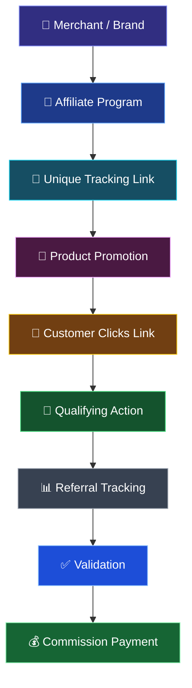

# 🚀 Affiliate Marketing
### A Powerful Model of Digital Marketing

<p align="center">
  
  
  
</p>

<p align="center">
  <b>Explore the digital ecosystem where brands, creators, and consumers connect through performance-based marketing.</b>
</p>

---

## 📖 Table of Contents

- [Project Overview](#-project-overview)
- [Project Objectives](#-project-objectives)
- [Project Details](#-project-details)
- [Introduction to Affiliate Marketing](#-introduction-to-affiliate-marketing)
- [How Affiliate Marketing Works](#-affiliate-marketing-workflow)
- [Key Participants](#-key-participants)
- [Commission Models](#-commission-models)
- [Marketing Channels](#-affiliate-marketing-channels)
- [Popular Affiliate Platforms](#-popular-affiliate-marketing-platforms)
- [Real-World Examples](#-real-world-examples)
- [Commission Calculation](#-commission-calculation)
- [Advantages and Challenges](#-advantages-and-challenges)
- [Ethical and Legal Considerations](#-ethical-and-legal-considerations)
- [Strategies for Success](#-strategies-for-success)
- [Future Trends](#-future-of-affiliate-marketing)
- [Team Members](#-team-members-and-contributions)
- [Key Learnings](#-key-learnings)
- [Repository Structure](#-repository-structure)
- [Conclusion](#-conclusion)

---

## 📌 Project Overview

Affiliate marketing is a performance-based digital marketing strategy in which individuals, publishers, or content creators promote products and services offered by businesses and earn commissions for eligible referrals, sales, leads, or other specified actions.

With the growth of e-commerce, social media, and content creation, affiliate marketing has become an important part of the digital business ecosystem. It allows businesses to reach new audiences through independent promoters while giving creators an opportunity to monetize their content.

This academic group project examines the concepts, processes, business models, promotional channels, benefits, challenges, and future opportunities associated with affiliate marketing.

## 🎯 Project Objectives

The main objectives of this project are to:

- Understand the meaning and fundamentals of affiliate marketing.
- Identify the major participants in the affiliate marketing ecosystem.
- Study the complete affiliate marketing workflow.
- Explore different commission structures and payment models.
- Understand how social media and digital content support product promotion.
- Examine popular affiliate marketing platforms.
- Calculate potential commissions using practical examples.
- Evaluate the advantages, challenges, and ethical responsibilities of affiliate marketing.
- Explore emerging trends in digital marketing and online commerce.

## 🎓 Project Details

| Detail | Information |
|---|---|
| **Project Title** | Affiliate Marketing — A Powerful Model of Digital Marketing |
| **Course** | Bachelor of Computer Applications (BCA) |
| **Department** | CSIT |
| **Project Type** | Academic Group Project |
| **Team Members** | Tanishtha, Ritesh, Yash, and Devashis |
| **Subject Teacher** | Ratnesh Srivastava Sir |

---

## 💡 Introduction to Affiliate Marketing

Affiliate marketing is a partnership-based promotional model that connects businesses with individuals or organizations capable of recommending their products or services to potential customers.

Unlike advertising models that may charge for impressions or exposure, many affiliate programs reward publishers for specific measurable actions, such as qualifying purchases or leads.

### Why Is Affiliate Marketing Important?

- **For businesses:** It creates additional promotional opportunities and can expand market reach.
- **For creators:** It offers a way to monetize useful content and recommendations.
- **For customers:** It helps them discover products through reviews, comparisons, tutorials, and recommendations.
- **For affiliate networks:** It provides a system for connecting advertisers with publishers and tracking performance.

### Affiliate Marketing vs. Traditional Advertising

| Affiliate Marketing | Traditional Advertising |
|---|---|
| Often rewards defined qualifying actions | May charge for impressions, clicks, placements, or campaigns |
| Uses tracking links or other attribution methods | May use reach, impressions, clicks, and other metrics |
| Relies on partnerships with publishers and creators | Often relies on paid media placements |
| Can connect promotion with measurable conversions | Results depend on the campaign and measurement method |

Both approaches can be used together as part of a broader digital marketing strategy.

---

## ⚡ Affiliate Marketing Workflow

The following workflow explains how a typical affiliate marketing transaction progresses from a business to a potential customer and, when the program's conditions are met, to a commission payment.



### Step-by-Step Process

1. **Merchant Registration:** A business creates or joins an affiliate program.
2. **Affiliate Enrollment:** A publisher or creator joins the program, subject to its eligibility requirements.
3. **Link Generation:** The affiliate receives a unique tracking link or another approved referral mechanism.
4. **Product Promotion:** The affiliate shares the product through a blog, website, video, social media post, or other channel.
5. **Customer Interaction:** A potential customer follows the referral link.
6. **Conversion:** The customer completes an action that qualifies under the program's rules.
7. **Tracking and Attribution:** The platform records the referral and attributes the conversion according to its tracking rules.
8. **Validation:** The merchant or platform verifies the transaction and checks applicable conditions, including cancellations or returns.
9. **Commission Payment:** The affiliate receives the approved commission according to the payment schedule and terms.

**Important:** A click does not automatically generate a commission. Payment depends on the action required by the particular affiliate program.

---

## 👥 Key Participants in Affiliate Marketing

### 1. Merchant or Advertiser
The company or individual offering a product or service for sale. The merchant defines the affiliate program, eligible actions, commission rules, and payment conditions.

### 2. Affiliate or Publisher
The individual, website owner, influencer, or content creator who promotes the merchant's offerings to an audience.

### 3. Customer
The person who discovers a product through an affiliate's content and may complete a qualifying purchase or other action.

### 4. Affiliate Network
A platform that can connect advertisers and publishers, manage tracking, provide reporting, and facilitate commission administration.

### 5. Tracking and Analytics Platform
The technology used to record clicks, attribute conversions, measure campaign performance, and report results.

---

## 💰 Commission Models

Affiliate programs use different payment structures depending on the product, service, and marketing objective.

| Model | Full Form | How It Works |
|---|---|---|
| **PPS** | Pay Per Sale | Commission is earned for a qualifying sale. |
| **PPC** | Pay Per Click | Payment is based on eligible clicks when the program uses this model. |
| **PPL** | Pay Per Lead | Commission is earned when a qualifying lead is generated. |
| **Recurring Commission** | Recurring Payments | Eligible commissions may recur for ongoing subscriptions or customer payments. |
| **CPA** | Cost Per Action / Acquisition | Payment is tied to a specified qualifying action, as defined by the program. |

The availability and precise definitions of these models vary by platform. Many programs use sale-based commissions rather than paying for every click.

---

## 📱 Affiliate Marketing Channels

Affiliates use different digital channels to reach audiences and share product recommendations.

### 1. Social Media Marketing
Platforms such as Instagram and Facebook allow creators to share recommendations, product demonstrations, short videos, and promotional content.

### 2. Video Marketing
YouTube creators can review products, publish tutorials, compare alternatives, and include affiliate links where permitted.

### 3. Blogging and Content Websites
Writers can create detailed reviews, buying guides, product comparisons, and educational articles.

### 4. Email Marketing
Publishers can recommend products to subscribers who have agreed to receive relevant communications.

### 5. Influencer Marketing
Creators can work with brands to promote products to audiences that trust their content.

### 6. Deal and Coupon Platforms
Affiliates can share offers, discounts, and shopping opportunities through approved websites or communities.

### 7. Search Engine Content
Useful articles and comparison pages can attract people who are actively researching products.

---

## 🌐 Popular Affiliate Marketing Platforms

The following platforms are examples of services associated with affiliate marketing and partnership programs.

| Platform | General Purpose |
|---|---|
| **Amazon Associates** | Affiliate promotion of eligible products sold through Amazon. |
| **EarnKaro** | Sharing eligible deals and earning referral commissions. |
| **Cuelinks** | Affiliate link monetization and campaign management. |
| **CJ Affiliate** | Connecting publishers with advertiser affiliate programs. |
| **Impact** | Managing affiliate and other business partnerships. |

Program availability, approval requirements, commission rates, and payment policies vary by platform and location.

---

## 🛍️ Real-World Examples

### Example 1: Technology Review on YouTube
A creator reviews a laptop and places an eligible affiliate link in the video description. A viewer follows the link and purchases the laptop. If the order qualifies under the program's rules, the creator may earn a commission.

### Example 2: Fashion Recommendations on Instagram
A creator shares a clothing collection with approved product links. Followers browse the products, and qualifying purchases may generate commissions.

### Example 3: Product Comparison Blog
A blogger compares several headphones, explaining their features, strengths, and limitations. Readers use the affiliate links to visit a retailer and may generate eligible sales.

### Example 4: Deal-Sharing Community
A publisher shares a verified shopping offer through an approved deal-sharing channel. Customers visit the retailer using the referral link, and eligible transactions may earn a commission.

These examples illustrate possible affiliate marketing workflows; actual results depend on the program and its terms.

---

## 🧮 Commission Calculation

Consider a product with a selling price of ₹2,000 and an affiliate commission rate of 5%.

| Description | Value |
|---|---:|
| Product Price | ₹2,000 |
| Commission Rate | 5% |
| Commission per Qualifying Sale | ₹100 |
| Qualifying Sales | 10 |
| Illustrative Total Commission | ₹1,000 |

### Formula

\[
\text{Commission}=\frac{\text{Eligible Sale Amount}\times\text{Commission Rate}}{100}
\]

For one qualifying sale:

\[
\frac{₹2,000\times5}{100}=₹100
\]

For ten qualifying sales at the same rate:

\[
10\times₹100=₹1,000
\]

These figures are illustrative. Actual commission calculations may exclude taxes, shipping, discounts, or ineligible products, depending on program rules. Cancellations and returns may also affect the final amount.

---

## 📊 Measuring Affiliate Marketing Performance

Tracking performance helps affiliates understand which campaigns provide useful results.

| Metric | Meaning |
|---|---|
| **Clicks** | Number of recorded clicks on affiliate links. |
| **Conversions** | Number of qualifying actions attributed to a campaign. |
| **Conversion Rate** | Percentage of clicks that result in conversions. |
| **Commission Earned** | Total commission credited for eligible activity. |
| **Average Order Value** | Average value of qualifying orders, where applicable. |
| **Earnings Per Click** | Commission earnings divided by the relevant number of clicks. |
| **Return on Investment** | Comparison of financial returns with campaign costs. |

### Example: Conversion Rate

If 500 visitors click an affiliate link and 25 complete a qualifying purchase:

\[
\text{Conversion Rate}=\frac{25}{500}\times100=5\%
\]

This means 5% of the recorded clicks resulted in qualifying purchases in this example.

---

## 🌟 Advantages of Affiliate Marketing

### Benefits for Businesses
- Expands promotional reach through external publishers.
- Creates opportunities to work with niche audiences.
- Can link advertising costs to measurable actions.
- Provides performance data for campaign evaluation.

### Benefits for Affiliates
- Offers opportunities to monetize useful content.
- Can be operated through multiple digital channels.
- May require less initial investment than selling and storing products directly.
- Allows creators to focus on topics relevant to their audiences.

### Benefits for Customers
- Provides product information, comparisons, and recommendations.
- Helps consumers discover products suited to their needs.
- Can make it easier to compare alternatives before purchasing.

---

## ⚠️ Challenges and Possible Solutions

| Challenge | Possible Solution |
|---|---|
| High competition | Focus on a specific audience or subject area. |
| Low conversion rates | Improve content quality and product relevance. |
| Changing commission rates | Review program policies and diversify where appropriate. |
| Tracking limitations | Understand attribution windows and use approved tracking methods. |
| Audience distrust | Provide honest reviews and disclose affiliate relationships. |
| Returns and cancellations | Understand the program's validation and reversal policies. |
| Dependence on third-party platforms | Maintain an independent website or audience channel when practical. |

---

## 🛡️ Ethical Practices in Affiliate Marketing

Responsible affiliate marketing helps protect consumers and maintain audience trust.

- **Transparency:** Clearly disclose affiliate relationships where required.
- **Honest Recommendations:** Explain a product's limitations as well as its benefits.
- **Accurate Information:** Avoid unsupported claims about products or earnings.
- **Privacy:** Follow applicable privacy requirements and platform policies.
- **Approved Promotion:** Follow the affiliate program's rules regarding links, advertising, and promotional channels.
- **Customer Interests:** Recommend products based on relevance rather than commission alone.

---

## 🚀 Strategies for Successful Affiliate Marketing

1. **Choose a Relevant Niche:** Focus on products and topics that match your knowledge and audience.
2. **Understand Your Audience:** Identify their interests, needs, and common questions.
3. **Create Useful Content:** Publish tutorials, reviews, comparisons, and practical demonstrations.
4. **Select Suitable Products:** Prioritize quality, relevance, and credibility.
5. **Use Appropriate Channels:** Choose social media, websites, videos, or email according to your audience.
6. **Track Performance:** Evaluate clicks, conversions, and commissions.
7. **Build Trust:** Make transparent recommendations and disclose affiliate relationships.
8. **Improve Continuously:** Use performance insights to refine content and promotional strategies.

---

## 🔮 Future of Affiliate Marketing

Affiliate marketing continues to develop alongside e-commerce and digital content creation.

### Artificial Intelligence
AI tools can assist with audience analysis, content planning, campaign optimization, and performance insights.

### Short-Form Video Commerce
Short videos and product demonstrations provide new ways to introduce products and direct interested viewers to retailers.

### Micro- and Nano-Influencers
Smaller creators may serve specialized audiences and build strong communities around specific interests.

### Personalized Recommendations
Relevant product recommendations can help users discover items that better match their needs.

### Mobile-First Shopping
Improved mobile experiences can make it easier for customers to move from product discovery to checkout.

### Data and Attribution
More sophisticated analytics can help businesses and affiliates evaluate campaign effectiveness, subject to privacy rules and platform limitations.

---

## 🧠 Key Learnings

Through this project, the team explored:

- The fundamental concept and purpose of affiliate marketing.
- The roles of merchants, affiliates, customers, and networks.
- The step-by-step affiliate marketing workflow.
- Different commission models and their applications.
- The use of social media, websites, blogs, and videos for promotion.
- The calculation and measurement of affiliate commissions.
- The advantages and challenges of performance-based marketing.
- The importance of transparency, privacy, and ethical promotion.
- Emerging opportunities in the digital marketing industry.

---

## 👥 Team Members and Contributions

This academic project was completed collaboratively, with each team member contributing to the preparation and presentation of the subject.

| Team Member | Role and Contribution |
|---|---|
| **Tanishtha** | Presentation delivery and explanation of the main topics. |
| **Ritesh** | Research, information collection, PowerPoint preparation, and content organization. |
| **Yash** | Technical support, troubleshooting, and assistance with the presentation and related work. |
| **Devashis** | Team coordination, collaboration, and assistance with overall project completion. |

**Subject Teacher:** Ratnesh Srivastava Sir

---

## 📂 Repository Structure

```text
affiliate-marketing-project/
│
├── README.md
└── Affiliate Marketing Presentation (1).pdf
```

| File | Description |
|---|---|
| `README.md` | Project overview, workflow, research topics, team contributions, and learning outcomes. |
| `Affiliate Marketing Presentation (1).pdf` | Original academic presentation slides. |

---

## 📖 How to View the Project

1. Open the presentation PDF in the repository.
2. Preview the slides on GitHub or download the PDF.
3. Open the downloaded file using any standard PDF reader.

This is a presentation-based academic project. It does not require software installation or a development environment.

---

## 🏁 Conclusion

Affiliate marketing is a significant component of modern digital marketing, connecting businesses, content creators, and consumers through measurable referrals and performance-based commissions.

This project demonstrates how affiliate marketing operates, how commission models work, how digital channels support product promotion, and how businesses and affiliates can evaluate their performance. It also highlights the importance of ethical practices, audience trust, accurate information, and evolving digital technologies.

By studying these concepts and practical examples, the team developed an understanding of affiliate marketing as both a digital business model and a growing area of online commerce.

---

<p align="center">
  <b>🎓 Academic Group Project | BCA | Department of CSIT</b>
  <br/>
  <b>Subject Teacher: Ratnesh Srivastava Sir</b>
  <br/>
  <i>Prepared by Tanishtha, Ritesh, Yash, and Devashis</i>
</p>
